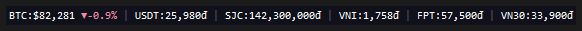
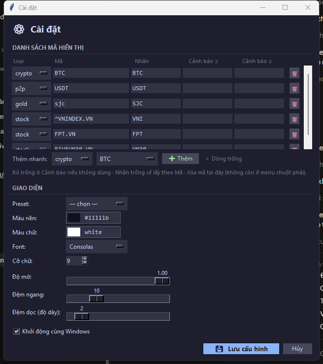

# Desktop Ticker Bar

Thanh hiển thị giá **luôn nổi trên desktop Windows**, viết bằng Python + Tkinter (single-file).
Theo dõi nhanh **Crypto / P2P (Binance)**, **Vàng SJC (vnappmob)** và **Chứng khoán Việt Nam (Yahoo Finance)** theo thời gian thực — gọn nhẹ, không chiếm cửa sổ.



> `BTC:$82,281 ▼-0.9%  |  USDT:25,980đ  |  SJC:142,300,000đ  |  VNI:1,758đ  |  FPT:57,500đ  |  VN30:33,900đ`

---

## ✨ Tính năng

### Hiển thị & nguồn giá
- **Đa nguồn**: Crypto & P2P (Binance), Vàng SJC (vnappmob), Chứng khoán/chỉ số VN (Yahoo Finance).
- **Chu kỳ riêng theo loại**: Crypto 10s · P2P 20s · Chứng khoán 30s · Vàng 60s — giảm gọi API thừa.
- **Tải song song** bằng `ThreadPoolExecutor`, không làm đơ giao diện.
- **Nhận biết giờ giao dịch**: mã sàn VN (`.VN`) ngừng cập nhật ngoài giờ (T2–T6, 9h–15h) sau khi đã có giá đóng cửa.
- **Offline cache**: mất mạng vẫn hiển thị giá gần nhất kèm dấu `*`; chưa có dữ liệu thì hiển thị `--`.
- **Fallback nguồn chứng khoán**: tự thử `query2.finance.yahoo.com` khi `query1` lỗi/chặn.
- **Tooltip chi tiết** khi rê chuột (cao/thấp/khối lượng…).

### Vị trí & thao tác
- **Kéo thả mọi chỗ** trên thanh; **tự hít mép** màn hình khi thả — theo *work area* nên **không đè lên taskbar**.
- **Hỗ trợ đa màn hình** (kéo được sang màn phụ).
- **Khóa vị trí** chống kéo nhầm và **Về vị trí mặc định** (menu chuột phải).
- **Menu chuột phải theo mã**: mở trang nguồn giá, di chuyển trái/phải.

### Cảnh báo giá
- Thêm `alert_above` / `alert_below` cho mã → khi vượt ngưỡng: **nhấp nháy nền + âm thanh + thông báo khay (balloon)**, ghi log vào `ticker.log`.

### Cửa sổ Cài đặt


- **Bảng thêm/sửa mã** trực quan (không cần gõ JSON) + **danh mục mã gợi ý** để thêm nhanh theo từng loại.
- **Theme picker**: màu nền / màu chữ, font, cỡ chữ, độ mờ, và **preset** (Tối / Sáng / Trong suốt).
- **Chỉnh kích thước**: đệm ngang & đệm dọc (độ dày thanh) độc lập với cỡ chữ.
- **Xem trước realtime**: kéo/chọn là đổi ngay; bấm **Hủy** sẽ hoàn tác.
- **Khởi động cùng Windows**: bật/tắt ngay trong Cài đặt.
- **Icon khay hệ thống (tùy chọn)**: cài thêm `pystray` + `Pillow` để Hiện/Ẩn nhanh.

---

## 🖥️ Nền tảng

Hiện ứng dụng **chỉ chạy trên Windows** (dùng các API riêng của Windows: nền trong suốt `-transparentcolor`, âm thanh `winsound`, registry autostart, đo kích thước desktop qua `ctypes`). macOS/Linux **chưa hỗ trợ** nếu không port lại các phần này.

---

## 🛠️ Cài đặt

Yêu cầu **Python 3.x** trên Windows.

```bash
pip install -r requirements.txt
```

`requests` + `urllib3` là bắt buộc; `pystray` + `Pillow` (tray icon) và `pytest` (chạy test) là tùy chọn.

## 🚀 Chạy

```bash
python ticker.py
```

Hoặc chạy ẩn console (chỉ hiện thanh giá):

```bash
pythonw ticker.py
```

**Thao tác nhanh:**
- Kéo chuột trái để di chuyển; thả gần mép sẽ tự canh sát mép.
- Double‑click hoặc chuột phải → **Cài đặt** để mở cấu hình.
- Chuột phải → **Khóa vị trí / Về vị trí mặc định / Tải lại ngay / Thoát**.

---

## ⚙️ Cấu hình (`config.json`)

File `config.json` tự tạo lần đầu và tự lưu khi bạn chỉnh trong Cài đặt (được `.gitignore`).

**Danh sách mã** — `symbols`:
```json
[
    {"type": "crypto", "symbol": "BTC", "label": "BTC"},
    {"type": "p2p",    "symbol": "USDT", "label": "USDT"},
    {"type": "gold",   "symbol": "sjc",  "label": "SJC"},
    {"type": "stock",  "symbol": "^VNINDEX.VN", "label": "VNI"},
    {"type": "stock",  "symbol": "FPT.VN", "label": "FPT"},
    {"type": "stock",  "symbol": "E1VFVN30.VN", "label": "VN30"}
]
```

| `type` | Nguồn | `symbol` ví dụ |
|--------|-------|----------------|
| `crypto` | Binance spot | `BTC`, `ETH` |
| `p2p` | Binance P2P (VND) | `USDT`, `USDC` |
| `gold` | Vàng SJC (vnappmob) | `sjc` |
| `stock` | Yahoo Finance | `FPT.VN`, `^VNINDEX.VN` (chỉ số), `E1VFVN30.VN` |

**Cảnh báo giá** (tùy chọn, mọi `type`):
```json
{"type": "crypto", "symbol": "BTC", "label": "BTC", "alert_above": 70000, "alert_below": 60000}
```

**Giao diện** — `theme` (tự lưu khi chỉnh trong Cài đặt):
```json
{
  "font_family": "Consolas", "font_size": 9,
  "bg": "#11111b", "fg": "white",
  "positive_color": "#a6e3a1", "negative_color": "#f38ba8",
  "separator_color": "#585b70", "alert_color": "#f9e2af",
  "opacity": 1.0, "pad_x": 10, "pad_y": 2
}
```
> Mẹo: đặt `"bg": "#000001"` để lấy lại kiểu nền **trong suốt hoàn toàn** (chỉ nổi chữ).

---

## 📦 Đóng gói file chạy (.exe) cho Windows

Tạo một file `.exe` chạy độc lập (không cần cài Python) bằng [PyInstaller](https://pyinstaller.org/):

```bash
pip install pyinstaller
pyinstaller --noconsole --onefile --name DesktopTickerBar ^
  --icon assets/icon.ico --version-file assets/version_info.txt ^
  --add-data "assets/icon.ico;assets" --add-data "assets/icon.png;assets" ticker.py
```

File chạy nằm ở `dist/DesktopTickerBar.exe` (đã có icon + thông tin phiên bản). `--noconsole` để không hiện cửa sổ console đen. *(Trên PowerShell/CMD dùng `^` để xuống dòng; gộp 1 dòng cũng được.)*

---

## 🧪 Phát triển & kiểm thử

```bash
python -m pytest tests/ -q
```

Logic thuần (định dạng giá, kẹp/hít cửa sổ, parse cấu hình…) được tách riêng để unit‑test; test dùng provider giả, **không gọi API thật** và không cần màn hình. Xem thêm [`CLAUDE.md`](CLAUDE.md) để hiểu kiến trúc & mô hình threading.
